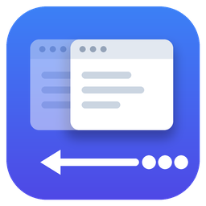
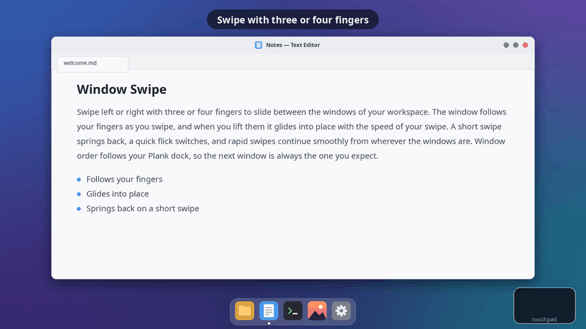
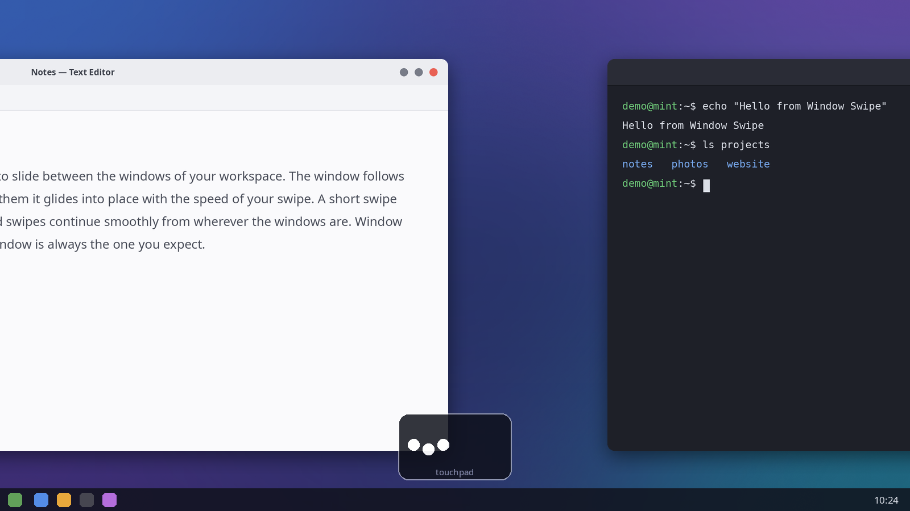
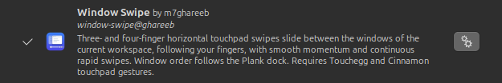
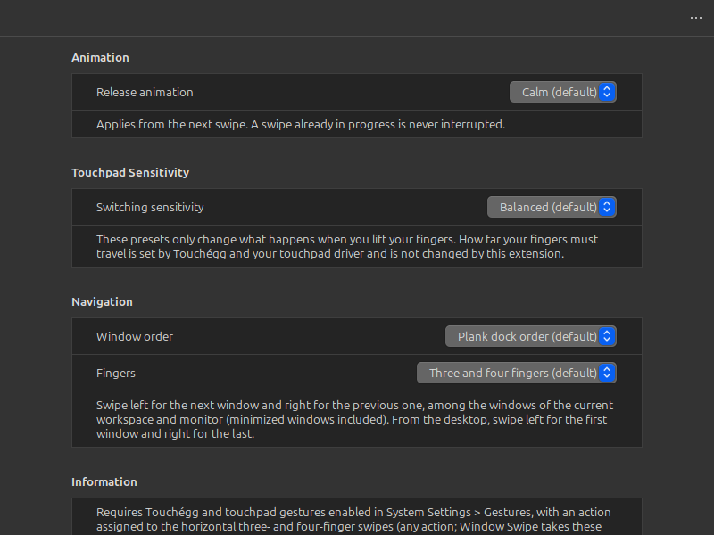

<p align="center"></p>

<h1 align="center">Window Swipe</h1>

<p align="center">
  <b>Slide between your windows with three- and four-finger touchpad swipes in the Cinnamon desktop.</b><br>
  Created by Mohamed Ghareeb (<a href="https://github.com/m7ghareeb">@m7ghareeb</a>)
</p>

<p align="center">
  <a href="https://github.com/m7ghareeb/window-swipe/releases/latest"></a>
  <a href="https://github.com/m7ghareeb/window-swipe/actions/workflows/validate.yml"></a>
  <a href="LICENSE"></a>
  
</p>

<p align="center"></p>

Window Swipe brings a macOS-inspired way of moving between windows to Linux Mint and the
Cinnamon desktop. Swipe sideways with three or four fingers: the current window slides away
and the next one slides in, **following your fingers**. When you lift them, the window glides
into place with the momentum of your swipe. Swipe several times quickly and each swipe picks up
smoothly from where the last one is.

**Contents:** [Features](#features) · [Requirements](#requirements) ·
[Installation](#installation) · [Gesture setup](#gesture-setup) · [Settings](#settings) ·
[Window order and Plank](#window-order-and-plank) · [Known limitations](#known-limitations) ·
[Troubleshooting](#troubleshooting) · [Getting help](#getting-help) ·
[Contributing](#contributing) · [License](#license-and-credits)

## Features

- **Follows your fingers.** Peek at the next window and change your mind before you let go.
- **Smooth, macOS-inspired animation.** The glide starts at your fingers' speed and comes to rest
  exactly on the window, with no jump and no overshoot.
- **Three- and four-finger swipes**, left and right. Use both, or only one of them.
- **Rapid swipes.** A new swipe takes over the moving windows instead of waiting for them.
- **Four animation profiles** and **five switching-sensitivity presets**, with the recommended
  **Calm** and **Balanced** as defaults.
- **Plank-aware order.** Windows follow their apps' order in the Plank dock, or the order they
  were opened in.
- **Every kind of window:** minimized, maximized and fullscreen windows, and the desktop, all
  take part in the slide.
- **Native settings window** in System Settings. Changes apply from the next swipe, with no
  restart.
- **Leaves everything else alone.** Your real windows never move during a slide, other gestures
  keep their actions, and disabling Window Swipe restores Cinnamon's normal behaviour.

<p align="center"></p>

## Requirements

| | |
|---|---|
| **Desktop** | Cinnamon 6.6 on X11 (Linux Mint 22.3 uses it) |
| **Gestures** | [Touchégg](https://github.com/JoseExposito/touchegg), which Linux Mint installs and runs for you |
| **Touchpad** | A touchpad that supports three- and four-finger gestures |
| **Optional** | [Plank](https://launchpad.net/plank), for windows in dock order |

**Tested on** Linux Mint 22.3 with Cinnamon 6.6.9 (X11), Touchégg 2.0.16 and a single
1920×1080 monitor. Other Cinnamon versions, Wayland and multiple monitors have not been tested
yet. If you try them, please [share how it went](https://github.com/m7ghareeb/window-swipe/discussions).

## Installation

### From Cinnamon Spices *(coming soon)*

Window Swipe is **not yet available** in the Cinnamon Spices catalogue. Once it is, you'll be
able to install it from **System Settings → Extensions → Download** and get updates there
automatically. Until then, install it from GitHub.

### From GitHub

Open a terminal and run:

```sh
cd ~/Downloads
wget https://github.com/m7ghareeb/window-swipe/releases/download/v1.0.0/window-swipe@ghareeb-v1.0.0.zip \
     https://github.com/m7ghareeb/window-swipe/releases/download/v1.0.0/SHA256SUMS
sha256sum -c SHA256SUMS      # should print: window-swipe@ghareeb-v1.0.0.zip: OK
mkdir -p ~/.local/share/cinnamon/extensions
unzip -o window-swipe@ghareeb-v1.0.0.zip -d ~/.local/share/cinnamon/extensions/
```

Then open **System Settings → Extensions**, select **Window Swipe** and click the **+**
button (*Enable*) at the bottom. A check mark appears next to it when it's enabled.

<p align="center"></p>

Prefer not to use a terminal? Download the zip from the
[releases page](https://github.com/m7ghareeb/window-swipe/releases/latest), extract it, and move
the `window-swipe@ghareeb` folder into `~/.local/share/cinnamon/extensions/` (in the file
manager, press **Ctrl+H** to show hidden folders).

The [installation guide](docs/installation.md) also covers updating and uninstalling.

## Gesture setup

Window Swipe receives swipes through Cinnamon's own gesture support. Check these once:

1. Open **System Settings → Gestures**. On the **Settings** tab, make sure **Enable gestures**
   is on.
2. On the **Swipe** tab, under **Swipe with 3 fingers** and **Swipe with 4 fingers**, check that
   **Left** and **Right** each have an action, not *Disabled*. Cinnamon's defaults already
   assign actions to them, so usually there is nothing to change.

**Any action works.** Cinnamon only passes on swipes that have an action. While Window Swipe is
enabled it handles these swipes itself, so the action doesn't run; it's used again if you turn
Window Swipe off or limit it to three or four fingers only.

Now swipe **left** with three or four fingers for the next window and **right** for the
previous one.

## Settings

Click the **gear** next to Window Swipe in **System Settings → Extensions**. Changes apply from
the next swipe. **More options (…) → Reset to defaults**, at the top right, brings back the
recommended settings.

<p align="center"></p>

**Animation**: how the window glides into place after you lift your fingers.

| Profile | Feel |
|---|---|
| Responsive | Quickest glide |
| Relaxed | A little calmer |
| **Calm** (default, recommended) | Smooth and unhurried |
| Gentle | Slowest, softest landing |

**Switching sensitivity**: whether lifting your fingers switches to the next window or goes back.

| Preset | Behaviour |
|---|---|
| **Balanced** (default, recommended) | Past halfway switches; a quick flick switches earlier; a short, slow swipe goes back. |
| Sensitive | Switches more easily: from 40 % for slow swipes, and with gentler flicks. |
| Less sensitive | Needs more: 60 % for slow swipes, and faster flicks. |
| Flick-friendly | Short, quick flicks switch; slow partial swipes still go back. |
| Deliberate | Mostly how far you swiped decides; only very fast flicks switch early. |

**Navigation**: the window order (below) and which finger counts Window Swipe uses: three and
four (default), three only, or four only.

The [configuration guide](docs/configuration.md) explains every setting in more detail.

## Window order and Plank

- With **Plank dock order** (the default), windows follow the order of their apps in your Plank
  dock. Apps that aren't pinned come after the pinned ones, in the order they were opened.
  Reorder the dock and the next swipe uses the new order.
- If Plank isn't running, or you choose **Window opening order**, windows simply follow the order
  they were opened in.
- The slide includes the normal windows of the **current workspace** on the **current monitor**.
  Swipe from the desktop to reach the first (left swipe) or last (right swipe) window. At
  either end of the list the window gives a little and springs back.

## Known limitations

- **One direction per swipe.** You can swipe toward a window and back, but not past the
  starting window to the other side within one swipe: Touchégg fixes a swipe's direction when
  it starts. Lift your fingers and swipe again; the new swipe continues smoothly.
- Only the current workspace and monitor are included. Multiple monitors haven't been tested.
- Windows that bypass the compositor, such as some games in exclusive fullscreen, are skipped.
- Tested on Cinnamon 6.6 (X11) only.

## Troubleshooting

| Problem | What to check |
|---|---|
| Nothing happens when I swipe | [Gesture setup](#gesture-setup): gestures enabled, and an action on Left and Right for 3 and 4 fingers. Is Window Swipe enabled? Is Touchégg running (`systemctl status touchegg`)? |
| My old action runs instead of a slide | Window Swipe is off, or the **Fingers** setting excludes that finger count. |
| A swipe does nothing while a menu is open | Intentional: swipes are ignored while a menu, Scale or Expo is open. |
| The window order looks wrong | See [Window order and Plank](#window-order-and-plank), or choose *Window opening order*. |

More answers and how to collect logs are in the [troubleshooting guide](docs/troubleshooting.md).

## Updates

Window Swipe isn't on Cinnamon Spices yet, so copies installed from GitHub aren't updated
automatically. **Watch → Custom → Releases** on this repository to be notified of new versions,
then follow [Updating](docs/installation.md#updating). Once Window Swipe is on Cinnamon Spices,
installing it from there will give you updates in **System Settings → Extensions**.

## Privacy

Window Swipe makes no network connections, runs no other programs and writes no files. Its only
data is its settings, which Cinnamon keeps in `~/.config/cinnamon/spices/window-swipe@ghareeb/`.

## Getting help

- **Questions, ideas and sharing your setup:** [GitHub Discussions](https://github.com/m7ghareeb/window-swipe/discussions)
  ([Q&A](https://github.com/m7ghareeb/window-swipe/discussions/categories/q-a),
  [Ideas](https://github.com/m7ghareeb/window-swipe/discussions/categories/ideas)).
- **Bugs and concrete feature requests:** [GitHub Issues](https://github.com/m7ghareeb/window-swipe/issues/new/choose).
- **Security problems:** report them privately, as described in [SECURITY.md](SECURITY.md).

## Contributing

Contributions are welcome: bug reports, fixes, documentation, new animation profiles and
translations. Fork the repository, make your change on a branch, test it on a real touchpad,
and open a pull request against `main`. Every pull request is reviewed by the maintainer, who
decides what is merged. See [CONTRIBUTING.md](CONTRIBUTING.md), the
[developer guide](docs/development.md) and the [Code of Conduct](CODE_OF_CONDUCT.md).

## License and credits

Window Swipe is free software, released under the
[GNU General Public License v3.0 or later](LICENSE). See the [changelog](CHANGELOG.md) and
[releases](https://github.com/m7ghareeb/window-swipe/releases) for version history.

**Created by Mohamed Ghareeb** · GitHub [@m7ghareeb](https://github.com/m7ghareeb)

Window Swipe builds on the Cinnamon desktop, the Muffin window manager and Touchégg.
